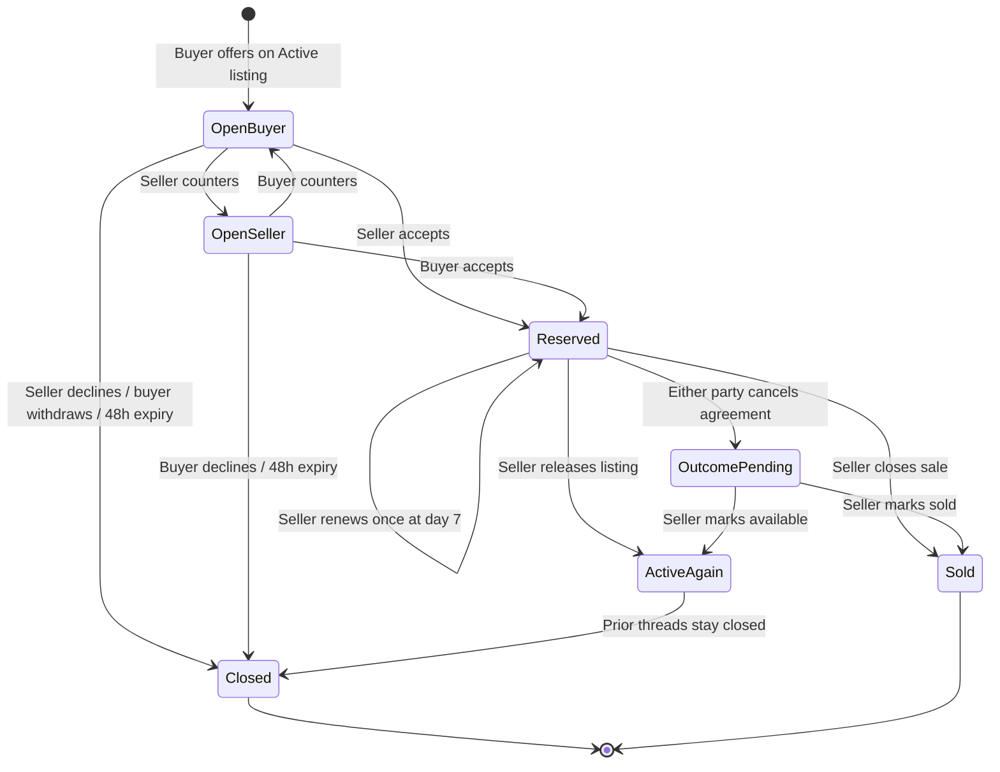

# Structured offers and reservations — approved product specification

Status: The founder approved this state table and offer wording on November 11, 2026. The price-only flow uses whole-dollar amounts, basic spam protection, and six-month retention for closed offer action history. This is the GBXMRKT-23/24/25 implementation contract. Marketplace Terms and Privacy Policy remain separate launch gates. This document does not activate offers in the application.

## Boundary and meaning

An offer is a private, structured price proposal between a verified-email buyer and the seller of one active, approved vehicle. It contains only a whole-dollar USD amount. An accepted proposal is a **nonbinding agreement in principle** and reserves the listing; it is not a completed sale, escrow instruction, title transfer, or commitment by Gearboxe to process vehicle purchase funds. Buyer and seller arrange inspection, payment, and transfer independently. The founder approved the offer wording on November 11, 2026; the marketplace Terms remain a separate launch gate.

The offer feature is unavailable on draft, pending, rejected, sold, withdrawn, archived, or already reserved listings. Reserved listings remain public with a Reserved badge. A verified buyer may ask an availability question through messaging while reserved but may not create a new offer.

## Input and abuse controls

| Field or action | Proposed rule | Reason |
| --- | --- | --- |
| Price | Whole U.S. dollars from $1 to $100,000,000, matching the current listing price ceiling; store integer cents or integer dollars consistently, never floating point money | Avoids ambiguous rounding and invalid amounts |
| New proposals/counters | Apply basic server-side per-account and per-listing throttling with a clear retry message; moderators can review abuse. The exact thresholds are an implementation control, not a product-facing quota. | Prevents rapid repeated offers without complicating the seller flow |
| Active thread | One current proposal per buyer–listing pair. A counter replaces the response opportunity on the preceding proposal; there is no fixed number of rounds | Prevents two simultaneously actionable prices in one negotiation |

Revisit throttling thresholds after observing actual demand and abuse. Do not add a note field or a fixed number of counter rounds to the launch flow.

## Time rules

- The server records each proposal's creation and exact expiry instant. A buyer offer or seller counter may be acted on only while `now < expiresAt`; at `now >= expiresAt` it is expired. Each counter starts a fresh 48-hour window. Read paths must treat elapsed proposals as expired even before a scheduled cleanup runs.
- Acceptance records a single server timestamp, the accepted price, and the accepted proposal ID. A seven-day reservation check is due at `acceptedAt + 7 days`. The seller may self-extend once for seven days. At the check, no response leaves the listing reserved and alerts founder/backup for follow-up. Further extensions require an authorized support decision and an audit reason.
- The listing's 45-day availability clock pauses while reserved. If the seller returns it to Active, a new full 45-day clock begins. A buyer cancellation alone never restarts that clock.
- The reservation check is a workflow prompt, not automatic release. Scheduled jobs must be idempotent and use the current reservation ID so delayed reminders cannot affect a later deal.

## State and authorized action table

The reservation check never changes status automatically. A moderation closure can disable offer actions from any state; the audit record preserves why.

| Current state | Actor and action | Required checks | Result |
| --- | --- | --- | --- |
| No offer thread; listing Active | Verified-email buyer submits price | Buyer is not seller, account active, listing still Active, abuse control, valid amount | Buyer proposal Open for 48 hours; seller notified privately |
| Open buyer proposal | Seller accepts | Seller owns listing; proposal unexpired; listing Active; no accepted reservation | Proposal Accepted and listing Reserved atomically; both parties notified |
| Open buyer proposal | Seller counters | Same seller and Active/unexpired checks; valid new price and abuse control | Prior proposal Superseded; seller counter Open for 48 hours; buyer notified |
| Open seller counter | Buyer accepts | Same buyer, verified email, unexpired; listing Active; no accepted reservation | Counter Accepted and listing Reserved atomically; both notified |
| Open seller counter | Buyer counters | Same buyer, verified email, Active/unexpired; valid new price and abuse control | Prior counter Superseded; buyer proposal Open for 48 hours; seller notified |
| Open proposal | Recipient declines | Correct recipient and unexpired proposal | Thread Declined; no reservation |
| Open buyer proposal or buyer response | Buyer withdraws before response | Correct buyer; proposal still open and unexpired | Thread Withdrawn; no reservation |
| Any open proposal | Clock reaches expiry | Server time reaches expiry | Proposal Expired; no acceptance/counter; sender may begin a fresh proposal while listing Active |
| One proposal accepted; listing Reserved | Either party cancels agreement | Participant identity and current reservation match | Agreement Canceled; listing stays Reserved until seller or moderator chooses outcome |
| Listing Reserved | Seller closes as Sold | Current seller or authorized moderator; audit reason | Listing Sold; outstanding proposals are permanently non-actionable |
| Listing Reserved | Seller closes as Available again | Current seller or authorized moderator; audit reason | Listing Active with new 45-day clock; all proposals from the prior listing generation become permanently stale; fresh offers required |
| Listing Reserved at day seven | Seller renews once | Current seller; no prior self-extension | Reservation remains; next check in seven days; audit entry |
| Listing Reserved at day seven | Seller does not respond | Current reservation still exists | Keep Reserved; alert founder/backup; no automatic acceptance of competing offers |
| Any state | Admin moderation closes/unpublishes listing | Existing moderation authorization and audit path | All offer actions disabled; participants retain their private history subject to retention policy |

The seller may consider and counter several buyers before accepting one. Once one proposal is accepted, every other unexpired proposal remains visible to its own participants but cannot be accepted or countered while Reserved. Each expires on its original schedule. After any reactivation, none revives, even if its original 48-hour window has time left.

## Concurrency and integrity rules

1. The acceptance mutation must reread the current listing, proposal, and reservation state in the same transaction. Only an Active listing with no accepted reservation can transition to Reserved. At most one accepted proposal/reservation can exist per listing generation.
2. Every action identifies the proposal version it acts on. A stale browser tab, expired proposal, withdrawn proposal, or counter that has superseded the proposal receives a clear conflict response and refreshes the current state; it never silently changes a later proposal.
3. Buyer and seller IDs come from authentication and listing ownership, never trusted request fields. A buyer cannot accept their own offer or send an offer to their own listing. Admin/support actions require role checks and an audit reason.
4. Reservation cancellation does not publish the listing. Only seller/authorized moderator closeout chooses Sold or Available again. Other offers cannot be accepted while that outcome is pending.
5. Listing edits or moderation changes that require reapproval disable new offer actions immediately. Existing accepted reservations require a documented support path before altering public status.

## Privacy, notifications, and records

- Price, participant identity, and action history are visible only to the two participants and authorized support with audited access. Public listing queries, search documents, notifications to unrelated users, SEO metadata, and email subject/body must not expose private offer terms.
- Send generic in-app and email notices for new offer, counter, acceptance, decline, expiry, cancellation, and reservation check as appropriate, respecting email preferences. The app remains the source of the proposal details; email links open an authenticated page.
- Retain an append-only action history with actor, proposal/version, timestamp, state change, and support reason while the offer thread is open. The founder chose a six-month retention period for closed offer action history. GBXMRKT-23 must define the closure event precisely, delete or irreversibly de-identify those records six calendar months after closure, and verify that backups and support exports follow the approved Privacy Policy. Do not promise the period in public copy until deletion is implemented and the Privacy Policy is approved. There is no offer-note field; ordinary message retention is governed separately.
- For retention, a thread closes when a proposal expires, is declined, or is withdrawn with no further open proposal; when the listing is sold or removed; or when a canceled or completed reservation receives its seller-controlled Sold/Available outcome. Reopening the listing creates a new thread generation and never resets the old thread's deletion date. A reservation that is still awaiting a seller outcome remains open for this purpose, even if its seven-day review is overdue.
- Apply existing messaging block and suspension rules to new offers and counteroffers. If either party blocks the other after acceptance, either participant may still cancel the nonbinding agreement and the seller may choose Sold or Available to close out the listing. A block does not reopen negotiation. Existing participant history remains available for support/appeal as permitted by account status and retention policy. The founder confirmed this closeout rule on November 14, 2026.

## Founder-approved offer wording

**Submit offer:** “Your offer is a price proposal to the seller. It expires in 48 hours unless the seller responds. Gearboxe does not process payment for the vehicle.”

**Counteroffer:** “The previous proposal is no longer open. The other person has 48 hours to accept, decline, or counter this price.”

**Accept:** “Accepting records a nonbinding agreement in principle and marks this listing Reserved. You and the other person still decide how to inspect, pay for, and transfer the vehicle. Gearboxe does not hold purchase funds.”

**Reserved, competing proposal:** “This vehicle is Reserved. Your proposal remains visible until it expires, but cannot be accepted while the reservation is active. If the vehicle becomes available again, send a new offer.”

**Reservation check:** “Your vehicle has been Reserved for seven days. Mark it Sold, make it Available again, or extend the reservation once for seven days. If you need more time after that, contact support.”

**Cancellation:** “Either person can end this nonbinding agreement. The seller must then mark the vehicle Sold or Available again; cancellation alone does not change the listing.”

## Verification and release handoff

- GBXMRKT-23 implements server states, access, basic spam protection, atomic acceptance, expiry, reservation checks, six-month history deletion, and audit history. GBXMRKT-24 implements participant UI and private notifications. GBXMRKT-25 preserves public Reserved visibility with accurate availability metadata. GBXMRKT-3 exercises the complete buyer–seller path and conflicting second acceptance in isolated staging.
- GBXMRKT-10 supplies verified-email buyer authorization. GBXMRKT-2 supplies approved Terms and Privacy versions. No offer feature is launch-ready until six-month deletion is implemented and verified and the separate Terms and Privacy gate is met.
